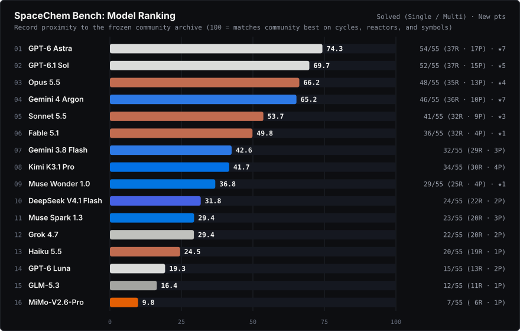
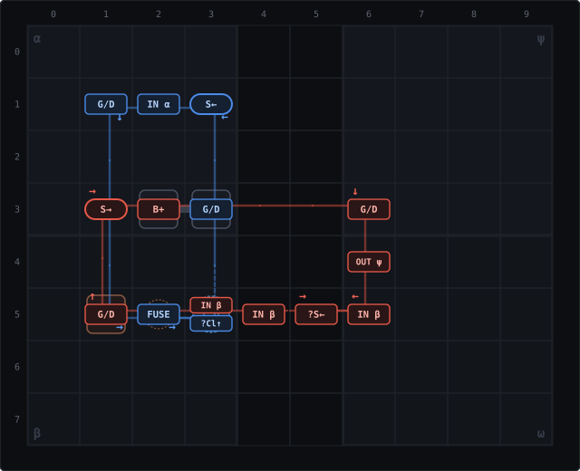
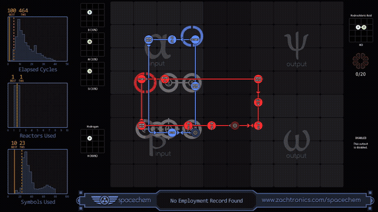
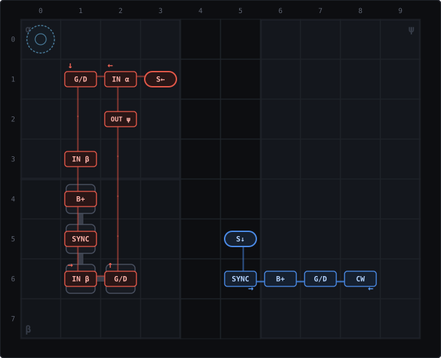
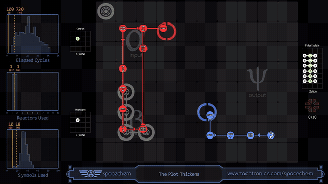
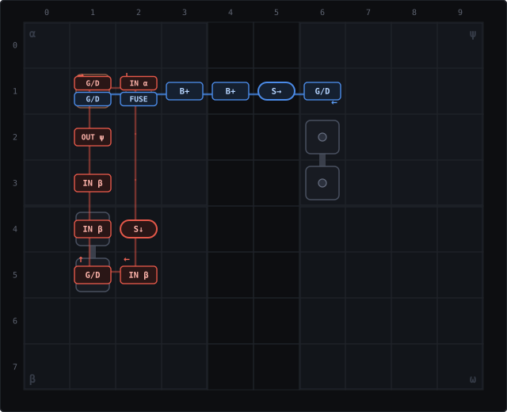
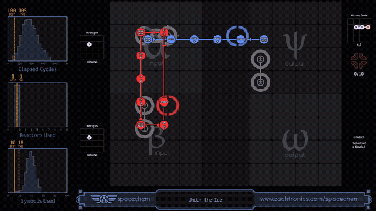
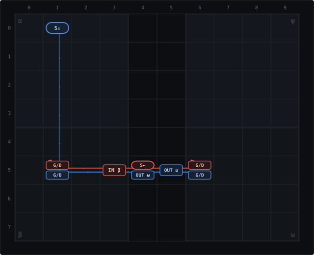
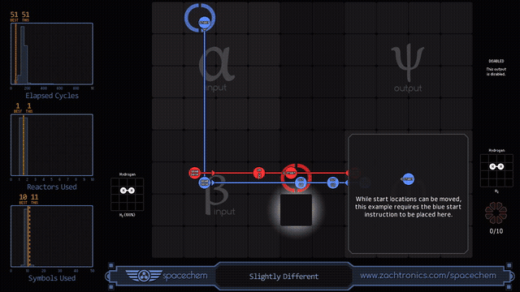
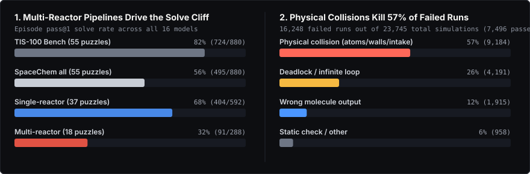

# SpaceChem Bench

**SpaceChem Bench: Can LLMs Beat Humans at 2D Spatial Programming?** [Read the article](https://spacechem.wincon.dev/) · [Browse all 55 puzzles](https://spacechem.wincon.dev/puzzles/) · [Companion: TIS-100 Bench](https://tis-100.wincon.dev/)

16 LLMs played all 55 non-boss puzzles of Zachtronics' 2D molecular programming game [SpaceChem](https://www.zachtronics.com/spacechem/) (46 main campaign, 6 from 63 Corvi, and 3 Team Fortress 2 levels: 37 single-reactor research puzzles and 18 multi-reactor production puzzles), with 10 to 60 minutes per puzzle and no access to the [community archive](https://github.com/spacechem-community-developers/spacechem-archive). They found **20 new Pareto-frontier points on 11 of 55 puzzles**, **11 of which knock an existing community solution off the frontier**. This release contains all 1,169 solutions on the models' Pareto frontiers in SpaceChem Community Edition export format, along with 10×8 reactor blueprints and in-game solution GIFs for every new frontier breakthrough.

Also on Hugging Face: [wincon-research/spacechem-bench](https://huggingface.co/datasets/wincon-research/spacechem-bench) (solutions and scores as a dataset table).

## Leaderboard

<p align="center">
  
</p>

| # | Model | Record proximity | Sum score | 3D hypervolume | Frontier coverage | Puzzles with new points | Solved | Single-reactor | Multi-reactor |
|---:|---|---:|---:|---:|---:|---:|---:|---:|---:|
| 1 | GPT-6 Astra | 74.3 | 67.8 | 69.7 | 57.4 | 5 (7) | 54 / 55 | 37 / 37 | 17 / 18 |
| 2 | GPT-6.1 Sol | 69.7 | 62.4 | 63.2 | 52.9 | 4 (5) | 52 / 55 | 37 / 37 | 15 / 18 |
| 3 | Opus 5.5 | 66.2 | 60.9 | 61.8 | 50.9 | 2 (4) | 48 / 55 | 35 / 37 | 13 / 18 |
| 4 | Gemini 4 Argon | 65.2 | 57.0 | 59.7 | 46.7 | 5 (7) | 46 / 55 | 36 / 37 | 10 / 18 |
| 5 | Sonnet 5.5 | 53.7 | 48.3 | 45.9 | 38.0 | 2 (3) | 41 / 55 | 32 / 37 | 9 / 18 |
| 6 | Fable 5.1 | 49.8 | 43.3 | 43.6 | 35.5 | 1 (1) | 36 / 55 | 32 / 37 | 4 / 18 |
| 7 | Gemini 3.8 Flash | 42.6 | 34.3 | 33.2 | 28.5 | 0 | 32 / 55 | 29 / 37 | 3 / 18 |
| 8 | Kimi K3.1 Pro | 41.7 | 32.5 | 28.3 | 26.2 | 0 | 34 / 55 | 30 / 37 | 4 / 18 |
| 9 | Muse Wonder 1.0 | 36.8 | 29.9 | 27.5 | 25.3 | 1 (1) | 29 / 55 | 25 / 37 | 4 / 18 |
| 10 | DeepSeek V4.1 Flash | 31.8 | 25.6 | 24.4 | 21.1 | 0 | 24 / 55 | 22 / 37 | 2 / 18 |
| 11 | Muse Spark 1.3 | 29.4 | 22.3 | 20.7 | 19.3 | 0 | 23 / 55 | 20 / 37 | 3 / 18 |
| 12 | Grok 4.7 | 29.4 | 24.7 | 22.3 | 19.9 | 0 | 22 / 55 | 20 / 37 | 2 / 18 |
| 13 | Haiku 5.5 | 24.5 | 19.0 | 16.7 | 15.5 | 0 | 20 / 55 | 19 / 37 | 1 / 18 |
| 14 | GPT-6 Luna | 19.3 | 14.2 | 12.0 | 11.8 | 0 | 15 / 55 | 13 / 37 | 2 / 18 |
| 15 | GLM-5.3 | 16.4 | 14.0 | 12.6 | 10.2 | 0 | 12 / 55 | 11 / 37 | 1 / 18 |
| 16 | MiMo-V2.6-Pro | 9.8 | 7.1 | 7.1 | 6.0 | 0 | 7 / 55 | 6 / 37 | 1 / 18 |

Snapshot `2026-11-04-v1`, one attempt per model and puzzle (pass@1). Point counts in parentheses are evaluated per model against the frozen archive (28 model points in total, which pool to 20 nondominated points across models).

## Featured reactors

Each new frontier point below pairs the 10×8 dual-waldo reactor blueprint (`blueprints/…`) with the solution running in the unmodified Linux game (`gifs/…`). Red and blue tracks show the two waldos' paths and instructions; α and β are the left-side input zones, and ψ and ω are the right-side output zones.

### 1. Random inputs and fusion: *No Employment Record Found* (`research_6`)

`research_6` feeds in boron, aluminum, or silicon at random and asks for hydrochloric acid (`H-Cl`). The reactor has to fuse each random atom up to chlorine, test it with an atomic sensor, and bond it to hydrogen. When we froze the community archive, the fastest 23-symbol solution took **501 cycles** (Haxton). Sonnet 5.5's first passing reactor two minutes in took 1,113 cycles; twenty minutes in it reached 465 cycles, and it finished with **`464/1/23`** (knocking both `501/1/23` by Haxton and `465/1/24` by 12345ieee off the frontier) and **`504/1/22`** (36 cycles faster than `540/1/22` by General_Lecter_). Opus 5.5 added **`548/1/21`**.

| 10×8 reactor layout (`464/1/23`, Sonnet 5.5) | Running in SpaceChem |
| :---: | :---: |
|  |  |

### 2. Two archive solutions beaten at once: *The Plot Thickens* (`mining_7`)

`mining_7` builds polyethylene chains from carbon and hydrogen and outputs them into a tall ψ zone. Gemini 4 Argon's **`720/1/18`** is faster and uses fewer symbols than two community solutions at once: `729/1/21` (Haxton) and `805/1/19` (Zemyla). Its red waldo runs a 2×6 loop near the left wall while the blue waldo shuttles along a single row with four instructions (`SYNC`, `B+`, `G/D`, `CW`). At the fast end of the same frontier, GPT-6.1 Sol added **`468/1/31`** and **`469/1/29`**.

| 10×8 reactor layout (`720/1/18`, Gemini 4 Argon) | Running in SpaceChem |
| :---: | :---: |
|  |  |

### 3. Fusion, 21 cycles faster: *Under the Ice* (`fusion_2`)

`fusion_2` makes nitrous oxide from hydrogen and nitrogen using a fuser. Gemini 4 Argon's **`105/1/18`** beats busdriver's `126/1/18` at the same symbol count (**17% faster**), and Argon also found **`102/1/19`** between the archive's `100/1/22` and `126/1/18`.

| 10×8 reactor layout (`105/1/18`, Gemini 4 Argon) | Running in SpaceChem |
| :---: | :---: |
|  |  |

### 4. A tutorial with a cycle to spare: *Slightly Different* (`research_tutorial_1`)

`research_tutorial_1` moves ten hydrogen molecules from β to ω. The archive's `52/1/11` (Ebola0001) and `53/1/10` (EvilMidget) already shuttle both waldos back and forth on one row instead of looping. GPT-6 Astra shifted the track one column left, adjusted the start cells, and found **`51/1/11`**. Astra, GPT-6.1 Sol, and Muse Wonder 1.0 each found **`52/1/10`**, beating both old solutions.

| 10×8 reactor layout (`51/1/11`, GPT-6 Astra) | Running in SpaceChem |
| :---: | :---: |
|  |  |

## Where 2D spatial programming breaks the models

<p align="center">
  
</p>

- **The multi-reactor cliff.** In [TIS-100 Bench](https://tis-100.wincon.dev/), the same 16 models solved 82% of episodes (724 of 880) and Opus 5.5 tied GPT-6 Astra at 55 of 55 solved. Moving to SpaceChem cuts overall solve rate to **56%** (495 of 880): **68%** on single-reactor puzzles (404 of 592) versus **32%** on multi-reactor production puzzles (91 of 288).
- **Collisions, not wrong chemistry, kill 57% of failed runs.** Across all episodes, models ran their reactors 23,745 times, and 7,496 (32%) passed. Of the 16,248 failed runs, **57%** (9,184) crashed from physical collisions (two atoms meeting in one cell, a rotated molecule clipping a wall, or a new input spawning onto an uncleared intake), **26%** (4,191) deadlocked in loops, and only **12%** (1,915) output the wrong molecule.
- **Tradeoffs rather than 1D records.** Whereas TIS-100 Bench produced three outright cycle records, no SpaceChem model beat the archive's best cycle, reactor, or symbol score on its own; all 20 new frontier points trade symbols for cycles inside a single reactor.

## All 20 new Pareto-frontier points

| Puzzle | Found by | Score (C/R/S) | Against the frozen archive | Artifacts |
|---|---|---:|---|---|
| No Employment Record Found (`research_6`) | Sonnet 5.5 | **464/1/23** | Beats 465/1/24 (12345ieee) and 501/1/23 (Haxton) (since improved to 463/1/23 by 12345ieee) | [CE export](programs/research_6/sonnet/research_6.464-1-23.txt) · [GIF](gifs/research_6/sonnet/research_6.464-1-23.gif) · [Blueprint](blueprints/research_6/sonnet/research_6.464-1-23.svg) |
| No Employment Record Found (`research_6`) | Sonnet 5.5 | **504/1/22** | Beats 540/1/22 (General_Lecter_) (since improved to 503/1/22 by 12345ieee) | [CE export](programs/research_6/sonnet/research_6.504-1-22.txt) · [GIF](gifs/research_6/sonnet/research_6.504-1-22.gif) · [Blueprint](blueprints/research_6/sonnet/research_6.504-1-22.svg) |
| No Employment Record Found (`research_6`) | Opus 5.5 | **548/1/21** | Fills the gap between 540/1/22 and 690/1/20 (since improved to 544/1/21 by 12345ieee) | [CE export](programs/research_6/opus/research_6.548-1-21.txt) · [GIF](gifs/research_6/opus/research_6.548-1-21.gif) · [Blueprint](blueprints/research_6/opus/research_6.548-1-21.svg) |
| Right All Along (`research_5`) | Gemini 4 Argon | **1,500/1/25** | Fills the gap between 1,021/1/26 and 1,877/1/19 | [CE export](programs/research_5/argon/research_5.1500-1-25.txt) · [GIF](gifs/research_5/argon/research_5.1500-1-25.gif) · [Blueprint](blueprints/research_5/argon/research_5.1500-1-25.svg) |
| Right All Along (`research_5`) | Gemini 4 Argon | **1,640/1/24** | Fills the gap between 1,021/1/26 and 1,877/1/19 | [CE export](programs/research_5/argon/research_5.1640-1-24.txt) · [GIF](gifs/research_5/argon/research_5.1640-1-24.gif) · [Blueprint](blueprints/research_5/argon/research_5.1640-1-24.svg) |
| Prelude to a Migraine (`sensing_2`) | Gemini 4 Argon | **69/1/13** | Beats 74/1/13 (xrdd) | [CE export](programs/sensing_2/argon/sensing_2.69-1-13.txt) · [GIF](gifs/sensing_2/argon/sensing_2.69-1-13.gif) · [Blueprint](blueprints/sensing_2/argon/sensing_2.69-1-13.svg) |
| Slightly Different (`research_tutorial_1`) | GPT-6 Astra | **51/1/11** | Beats 52/1/11 (Ebola0001) | [CE export](programs/research_tutorial_1/astra/research_tutorial_1.51-1-11.txt) · [GIF](gifs/research_tutorial_1/astra/research_tutorial_1.51-1-11.gif) · [Blueprint](blueprints/research_tutorial_1/astra/research_tutorial_1.51-1-11.svg) |
| Slightly Different (`research_tutorial_1`) | GPT-6 Astra, GPT-6.1 Sol, Muse Wonder 1.0 | **52/1/10** | Beats 52/1/11 (Ebola0001) and 53/1/10 (EvilMidget) | [CE export](programs/research_tutorial_1/astra/research_tutorial_1.52-1-10.txt) · [GIF](gifs/research_tutorial_1/astra/research_tutorial_1.52-1-10.gif) · [Blueprint](blueprints/research_tutorial_1/astra/research_tutorial_1.52-1-10.svg) |
| Like a Boss (`mining_2`) | GPT-6.1 Sol | **273/1/24** | Fills the gap between 249/1/26 and 304/1/21 | [CE export](programs/mining_2/sol/mining_2.273-1-24.txt) · [GIF](gifs/mining_2/sol/mining_2.273-1-24.gif) · [Blueprint](blueprints/mining_2/sol/mining_2.273-1-24.svg) |
| An Introduction to Sensing (`sensing_1`) | Sonnet 5.5 | **146/1/21** | Beats 146/1/22 (Biblin) | [CE export](programs/sensing_1/sonnet/sensing_1.146-1-21.txt) · [GIF](gifs/sensing_1/sonnet/sensing_1.146-1-21.gif) · [Blueprint](blueprints/sensing_1/sonnet/sensing_1.146-1-21.svg) |
| An Introduction to Sensing (`sensing_1`) | GPT-6 Astra | **161/1/17** | Beats 162/1/17 (cake-pie) | [CE export](programs/sensing_1/astra/sensing_1.161-1-17.txt) · [GIF](gifs/sensing_1/astra/sensing_1.161-1-17.gif) · [Blueprint](blueprints/sensing_1/astra/sensing_1.161-1-17.svg) |
| Under the Ice (`fusion_2`) | Gemini 4 Argon | **102/1/19** | Fills the gap between 100/1/22 and 126/1/18 | [CE export](programs/fusion_2/argon/fusion_2.102-1-19.txt) · [GIF](gifs/fusion_2/argon/fusion_2.102-1-19.gif) · [Blueprint](blueprints/fusion_2/argon/fusion_2.102-1-19.svg) |
| Under the Ice (`fusion_2`) | Gemini 4 Argon | **105/1/18** | Beats 126/1/18 (busdriver) | [CE export](programs/fusion_2/argon/fusion_2.105-1-18.txt) · [GIF](gifs/fusion_2/argon/fusion_2.105-1-18.gif) · [Blueprint](blueprints/fusion_2/argon/fusion_2.105-1-18.svg) |
| Ice to Meet You (`fusion_1`) | Fable 5.1 | **92/1/15** | Fills the gap between 76/1/16 and 103/1/14 | [CE export](programs/fusion_1/fable/fusion_1.92-1-15.txt) · [GIF](gifs/fusion_1/fable/fusion_1.92-1-15.gif) · [Blueprint](blueprints/fusion_1/fable/fusion_1.92-1-15.svg) |
| The Plot Thickens (`mining_7`) | GPT-6.1 Sol | **468/1/31** | Fills the gap between 449/1/34 and 551/1/27 | [CE export](programs/mining_7/sol/mining_7.468-1-31.txt) · [GIF](gifs/mining_7/sol/mining_7.468-1-31.gif) · [Blueprint](blueprints/mining_7/sol/mining_7.468-1-31.svg) |
| The Plot Thickens (`mining_7`) | GPT-6.1 Sol | **469/1/29** | Fills the gap between 449/1/34 and 551/1/27 | [CE export](programs/mining_7/sol/mining_7.469-1-29.txt) · [GIF](gifs/mining_7/sol/mining_7.469-1-29.gif) · [Blueprint](blueprints/mining_7/sol/mining_7.469-1-29.svg) |
| The Plot Thickens (`mining_7`) | Gemini 4 Argon | **720/1/18** | Beats 729/1/21 (Haxton) and 805/1/19 (Zemyla) | [CE export](programs/mining_7/argon/mining_7.720-1-18.txt) · [GIF](gifs/mining_7/argon/mining_7.720-1-18.gif) · [Blueprint](blueprints/mining_7/argon/mining_7.720-1-18.svg) |
| Moustachium 604 (`tf2_2`) | Gemini 4 Argon | **165/1/12** | Beats 173/1/12 (DarkJak568) | [CE export](programs/tf2_2/argon/tf2_2.165-1-12.txt) · [GIF](gifs/tf2_2/argon/tf2_2.165-1-12.gif) · [Blueprint](blueprints/tf2_2/argon/tf2_2.165-1-12.svg) |
| Moustachium 604 (`tf2_2`) | GPT-6 Astra | **288/1/10** | Beats 314/1/10 (12345ieee) | [CE export](programs/tf2_2/astra/tf2_2.288-1-10.txt) · [GIF](gifs/tf2_2/astra/tf2_2.288-1-10.gif) · [Blueprint](blueprints/tf2_2/astra/tf2_2.288-1-10.svg) |
| QT-4 (`quantum_5`) | GPT-6 Astra | **617/1/21** | Fills the gap between 449/1/22 and 917/1/19 | [CE export](programs/quantum_5/astra/quantum_5.617-1-21.txt) · [GIF](gifs/quantum_5/astra/quantum_5.617-1-21.gif) · [Blueprint](blueprints/quantum_5/astra/quantum_5.617-1-21.svg) |

## Co-discovery with the SpaceChem community

SpaceChem Bench started with a challenge on the Zachtronics Discord. After early LLM benchmarks came out on [Opus Magnum](https://opusmagnumbench.com/) and [TIS-100](https://tis-100.wincon.dev/), `@12345ieee`, who holds hundreds of records in the SpaceChem archive, asked when models would come to SpaceChem:

<p align="center">
  
</p>

When our runs finished, two of the models' new frontier points beat `12345ieee`'s own solutions in the frozen archive: `465/1/24` on *No Employment Record Found* (`research_6`) and `314/1/10` on *Moustachium 604* (`tf2_2`). We submitted selected frontier solutions to the [community archive](https://github.com/spacechem-community-developers/spacechem-archive) on October 27, including Sonnet 5.5's, GPT-6 Astra's, and Opus 5.5's four new points on `research_6`.

Three days later, `12345ieee` came back and posted **`463/1/23`**, **`462/1/24`**, **`503/1/22`**, and **`544/1/21`** on `research_6`, each one to four cycles faster than the model solution it replaced. The new files share most of their lines with the model files: `463/1/23` keeps Sonnet's layout, moving one red bond instruction and shifting a three-arrow corner by one cell (4 of the 29 `MEMBER` lines).

## Files

- `programs/<puzzle>/<model>/<puzzle>.<cycles>-<reactors>-<symbols>.txt`: one file per solution (1,169 files), in
  SpaceChem Community Edition export format and named like the community archive's files.
- `gifs/<puzzle>/<model>/<puzzle>.<cycles>-<reactors>-<symbols>.gif`: animated in-game recordings of all 28
  validated model frontier breakthroughs (recordings for all 1,169 solutions are hosted at `https://spacechem.wincon.dev/gifs/…`).
- `blueprints/<puzzle>/<model>/<puzzle>.<cycles>-<reactors>-<symbols>.svg`: 10×8 dual-waldo reactor diagrams for all
  28 validated model frontier breakthroughs.
- `points.csv`: every solution with its puzzle, difficulty, kind, model, scores, whether it is a new frontier point, and
  paths to its `.txt` export, `.gif` recording, and `.svg` blueprint.
- `models.csv`: the 16-model leaderboard above.

## Method

Each model had one scored attempt per puzzle (pass@1): build a working solution, then keep improving it across
all three of the game's scores (cycles, reactors, symbols). Time limits were 10, 40, and 60 minutes for easy, medium,
and hard puzzles. Models used text tools against the unmodified Linux game on a virtual display and had no access to
screenshots or the community archive.

Every solution on a model's final Pareto frontier was rebuilt from the model's edits, replayed in a fresh game, and
checked with [SChem](https://github.com/spacechem-community-developers/SChem) (`--check-precog`), which replays random-input puzzles across alternate seeds to reject
precognitive solutions that rely on the game's fixed RNG seed. A point counts as a **new frontier point** when it
replays cleanly, passes the precognition check, and no solution in the [community archive](https://github.com/spacechem-community-developers/spacechem-archive) (frozen on
October 18, 2026 at commit `3d749c1`, excluding precognitive and bug-abusing categories) ties or beats it
on all three scores at once.

- **Record proximity** is the community's best score divided by the model's best, averaged over the three scores and all
  55 puzzles (×100; unsolved puzzles count as 0), even when a model's best cycle, reactor, and symbol
  scores come from different solutions.
- **Sum score**, following [Opus Magnum Bench](https://opusmagnumbench.com/), compares the single solution with the
  lowest combined `cycles + reactors + symbols` against the lowest sum in the community archive (×100).
- **3D hypervolume** measures the volume of score space dominated by the model's Pareto frontier up to a reference box
  at 2× the community's maximum scores, divided by the community frontier's dominated volume (×100).
- **Frontier coverage** (reciprocal multiplicative ε) takes the worst-case coordinate ratio needed for the model's
  frontier to cover every point on the community Pareto frontier at once (×100).

28 rows are flagged as new frontier points across the 16 models. Pooling across models deduplicates shared
discoveries (such as `52/1/10` on `research_tutorial_1`) and drops six points superseded by another model on
`research_6`, `sensing_1`, and `fusion_1`, leaving **20 distinct nondominated points** across
**11 puzzles**.

Full methods, interactive trajectories, and the Pareto explorer are in the [article](https://spacechem.wincon.dev/).

## Verify a solution

Solutions are in SpaceChem Community Edition export format and can be imported directly into SpaceChem or
validated from the command line with [SChem](https://github.com/spacechem-community-developers/SChem):

```sh
SChem --check-precog programs/research_6/sonnet/research_6.464-1-23.txt
```

## License and credit

MIT. Credit solutions as "Wincon (model name)". SpaceChem, TIS-100, and Opus Magnum are trademarks of Zachtronics; Team Fortress 2 is a trademark of Valve. This project is not affiliated with or endorsed by Zachtronics, Valve, or any model provider.

Research teams can ask us for the RL environment and episode traces: hello@wincon.dev.

## Citation

```bibtex
@misc{wincon2026spacechembench,
  title  = {SpaceChem Bench: Can LLMs Beat Humans at 2D Spatial Programming?},
  author = {{Wincon}},
  year   = {2026},
  month  = nov,
  url    = {https://spacechem.wincon.dev/},
  note   = {Benchmark snapshot 2026-11-04-v1}
}
```
